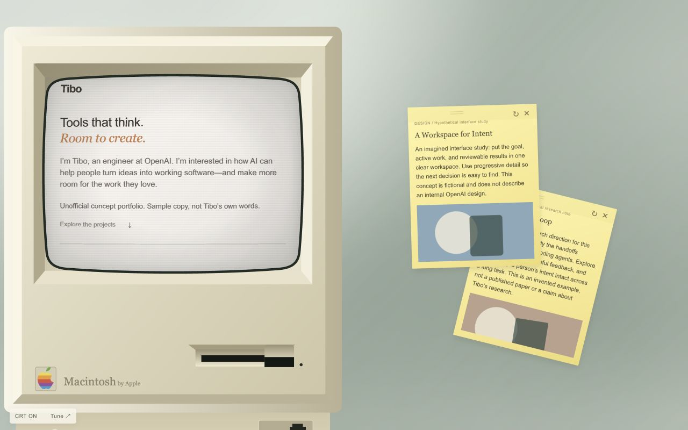

# Retro Portfolio

A free, retro-computer portfolio template with a curved CRT display and project notes you can drag, rotate, and collect. Built with plain HTML, CSS, and JavaScript. No packages or build step. Demo images are bundled locally.



[Live demo](https://alanli28.github.io/retro-portfolio/) · [Use this template](https://github.com/alanli28/retro-portfolio/generate)

## Try it locally

```sh
python3 -m http.server 4173
```

Open http://localhost:4173. Scroll inside the computer, open a project, then drag the top edge of its note or use the rotation handle. Use **CRT ON/OFF** and **Tune** to adjust the display, layout, and background.

## Make it yours

Edit **config.js**: name, page title, headline, biography, contact link (or email), footer, and projects. The default demo imagines a portfolio for Thibault “Tibo” Sottiaux at OpenAI. Biography prose is invented sample copy, not a quotation. Project cards reference public team work and a public appearance. Research cards link to real related papers and code; Design cards study public interfaces. These are editorial examples, not claims of personal authorship. Selected-work covers are original, simple SVG icons. Sticky notes omit decorative covers; an optional `noteImage` is used only for explanatory imagery, such as the CLI interface. See [image credits](ATTRIBUTION.md).

Each project has `title`, `tag` (`research`, `design`, or `project`), `context`, `image`, `summary`, `text`, and optional `links` and `noteImage`. Put images in `assets/projects/` and set `image` to the filename. Optional `video` accepts a relative URL or an HTTPS URL. Add links as `["Visit project", "https://example.com"]` pairs. Keep content as plain text. Customize colors and layout in `style.css`; display settings live in `crt.js`.

## Deploy

- **GitHub Pages:** repository Settings → Pages → Deploy from a branch → `main` → `/ (root)`.
- **Vercel / Netlify:** import the repository, choose a static/Other project, leave the build command empty, and publish the repository root.
- **Any static host:** upload the HTML, JS, CSS, favicon, and `assets/` directory together.

## Design and browser notes

The screen scrolls independently from the surrounding scene. Project notes float over the desktop and have their own scrolling. The layout adapts to smaller screens; this is intentionally a miniature-computer presentation. The opening animation respects reduced-motion preferences. CRT distortion uses SVG filters, whose appearance varies by browser; CRT OFF removes the effect.

No analytics, cookies, remote fonts, personal documents, or external storage are included. The default contact points to Tibo’s public X profile; no private email or personal documents are included. Replace the public contact, name, and sample work before deploying your own portfolio.

## About the example

This is an unofficial, speculative template demonstration. It is not Tibo’s website and is not affiliated with or endorsed by Tibo or OpenAI. It does not claim that Tibo authored the listed papers or personally designed the featured interfaces. The public identity and Codex connection are based on this [OpenAI Forum speaker introduction](https://forum.openai.com/public/events/codex-is-for-everyone-why-codex-matters-beyond-code-fa40puy7wi). The first-person biography and project presentation are imagined for demonstration.

To use a neutral identity, change `name`, `title`, `bio`, `contactLabel`, `contactUrl`, `footer`, and `projects` in `config.js`. Remove `caseNotice` when you have replaced the demo with your own content. You can use `email` instead of `contactUrl` / `contactLabel`.

## Contributing

Useful contributions include browser fixes, mobile usability improvements, and new visual themes. Please describe the change and include before/after screenshots for visual updates.

## Credits

The CRT visual direction and adjustable display controls were inspired by [gingerbeardman’s WebGL CRT Shader (Serenity Shader)](https://github.com/gingerbeardman/webgl-crt-shader). Thank you for sharing the original project. This template’s current CRT implementation uses SVG displacement filters and CSS overlays; it does not bundle the original WebGL shader. See [ATTRIBUTION.md](ATTRIBUTION.md) for source and image credits.

## License

Template code and original SVG sample illustrations are provided under the MIT license. Third-party product artwork and paper previews retain their original rights and are excluded from the MIT grant; see [ATTRIBUTION.md](ATTRIBUTION.md). The retro computer illustration is inspired by classic Macintosh hardware; product names and brand marks belong to their respective owners and are not granted by the software license. No affiliation or endorsement is implied.
